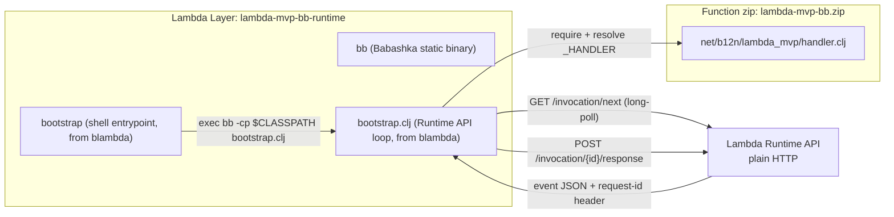

# lambda-mvp-bb: AWS Lambda custom runtime in Babashka (via blambda)

Runs [Babashka](https://babashka.org) on AWS Lambda as a custom runtime, using
[blambda](https://github.com/jmglov/blambda), which wraps
[bb-lambda](https://github.com/tatut/bb-lambda)'s Runtime API loop. Nothing is
compiled ahead of time, unlike the family's other custom runtimes: Babashka's
static binary starts in the execution environment, and its SCI interpreter
`require`s the handler at cold start.

The project is small on purpose: a demo handler (greeting, event echo,
warm-invocation counter) and a `bb bench` tool that compares cold and warm boot
times across memory tiers on your own AWS account. There's no function URL or
public endpoint; everything goes through `aws lambda invoke`.

## Status

Early release, the fifth sibling in the `lambda-mvp-*` family. Task names,
defaults and `bb bench`'s output may change without notice, so pin a commit or
tag if you depend on them.

## How it works



blambda's `bootstrap` script hardcodes `LAYERS_DIR=/opt`, where Lambda mounts
layers, so this is the only sibling whose runtime ships as a Lambda Layer
instead of inside one self-contained zip. `docs/guide/runtime-layer-build.md`
explains the two-artifact build.

- `src/net/b12n/lambda_mvp/handler.clj` is the demo handler. Swap in your own.
- blambda's `resources/bootstrap` and `resources/bootstrap.clj` are the Runtime
  API loop, used unchanged.
- `tools/mock_runtime_api.py` mocks the Runtime API, so the whole loop runs
  offline.

`docs/guide/architecture.md` has the whole-system view.

## Requirements

- [babashka](https://babashka.org) on PATH (`brew install
  borkdude/brew/babashka`). It's both the task runner and the Lambda runtime.
- AWS CLI v2, and credentials it can already use (`AWS_PROFILE`/`AWS_REGION`,
  or `aws configure`). Nothing in the repo hardcodes a profile, account or
  region.

You don't need Docker, unlike the Jolt and jank siblings.

## Quickstart

```sh
bb probe          # offline e2e: mock Runtime API + blambda's real loop (no AWS, no Docker)
bb test           # run the unit tests (no AWS, no Docker)
bb demo           # build + deploy + invoke in one go, prerequisites checked first
bb build          # bb blambda build-runtime-layer + build-lambda -> two zips in target/
bb deploy         # idempotent: publish the runtime layer, create/update the IAM role + function
bb invoke         # single ad-hoc invoke, prints the response body + REPORT line
bb bench          # cold/warm boot-time comparison across memory tiers
bb teardown       # delete the function, role, and every published layer version
```

`bb build` targets `arm64` unless you set `LAMBDA_ARCH=x86_64` (or `amd64`);
Babashka publishes static binaries for both. `LAMBDA_MVP_FUNCTION_NAME`
overrides the function name (`lambda-mvp-bb`) and the role name
(`lambda-mvp-bb-role`). `BENCH_MEMORY_TIERS` (default `2048,3008`) and
`BENCH_WARM_SAMPLES` (default `5`) set `bb bench`'s tiers and warm-sample count.

## Cold vs. warm boot time

[`docs/guide/cold-warm-boot.md`](docs/guide/cold-warm-boot.md) explains what
`bb bench` measures and has this project's numbers.
[`docs/guide/five-way-comparison.md`](docs/guide/five-way-comparison.md) puts
them next to the other `lambda-mvp-*` siblings.

## Extension points

Not built here, but easy to add:

- A deps layer (`bb blambda build-deps-layer`) plus `awyeah-api`, for an
  S3- or DynamoDB-backed handler like blambda's `site-analyser` example.
- Pods via `babashka.pods`, for capabilities outside Babashka's built-in
  namespaces.
- A Function URL with a bearer token, to reach the demo over HTTP.

## References

- [blambda](https://github.com/jmglov/blambda),
  [bb-lambda](https://github.com/tatut/bb-lambda) (which blambda wraps) and
  [Babashka](https://babashka.org)
- The siblings: [lambda-mvp-cljs](https://github.com/b12n-oss/lambda-mvp-cljs)
  (ClojureScript), [lambda-mvp-cljrfc](https://github.com/b12n-oss/lambda-mvp-cljrfc)
  (Clojurific), [lambda-mvp-jlt](https://github.com/b12n-oss/lambda-mvp-jlt)
  (Jolt), [lambda-mvp-jnk](https://github.com/b12n-oss/lambda-mvp-jnk) (jank),
  [lambda-mvp-rst](https://github.com/b12n-oss/lambda-mvp-rst) (Jolt with Rust)
  and [lambda-mvp-glj](https://github.com/b12n-oss/lambda-mvp-glj) (Glojure)
- [AWS Lambda Runtime API / custom runtimes](https://docs.aws.amazon.com/lambda/latest/dg/runtimes-custom.html)

## License

EPL 2.0, see `LICENSE`.
